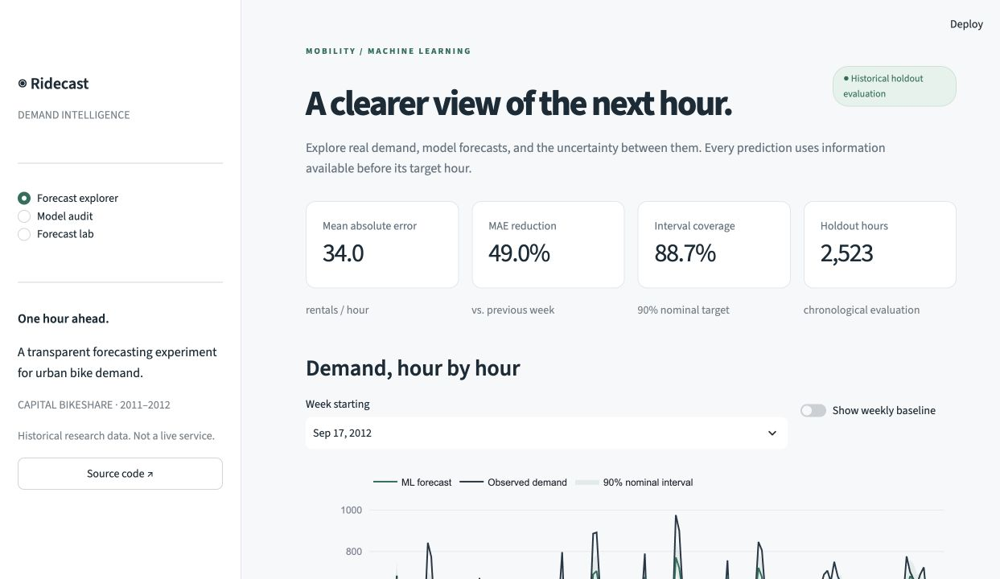
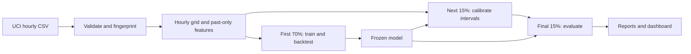

# Ridecast

**One hour ahead. Evaluated honestly.**

Ridecast is a reproducible machine-learning project that forecasts hourly bike rentals
and makes the evaluation inspectable. It pairs a Python training pipeline with an
interactive Streamlit workbench: compare forecasts with observations, inspect the
largest misses, audit chronological splits, and run sensitivity experiments.

It uses real historical Capital Bikeshare data from the [UCI Bike Sharing dataset](https://archive.ics.uci.edu/dataset/275/bike+sharing+dataset).
This is an offline portfolio experiment, not a live demand service.

The recorded run used **17,379 real hourly observations**. On **2,523 later test
hours**, the primary model achieved **33.99 rentals/hour MAE**, a **49.0% reduction**
against the stronger simple baseline. Nominal 90% prediction intervals covered
**88.7%** of test observations. The no-weather ablation performed better than the
primary model; all results, including that finding, are [reported together](docs/RESULTS.md).



## Run locally

Requires Python 3.11 or newer. Python 3.13 was used for the recorded run.

```bash
git clone https://github.com/HarryCain/ridecast.git
cd ridecast
python3 -m venv .venv
source .venv/bin/activate
pip install -r requirements.lock
pip install --no-build-isolation --no-deps -e .
streamlit run app.py
```

The committed report artifacts power **Forecast explorer** and **Model audit** immediately.
To reproduce the experiment and enable **Forecast lab**, run:

```bash
python -m ridecast train
pytest -q
```

The training command downloads the public dataset on first use, then caches it in
`data/raw/`. It writes a locally trained model, inference features, evaluation
predictions, metrics, backtests, feature diagnostics, and [measured results with resume bullets](docs/RESULTS.md).
You can supply the original UCI CSV with `python -m ridecast train --csv /path/to/hour.csv`.
Only load model files you generated or trust; joblib is a Python serialization format.

For a fresh development install rather than the recorded dependency set:

```bash
pip install -e '.[dev]'
```

## What makes the experiment useful

- **Clock-aware features.** Reindex to an hourly grid before computing lags. A missing record is unknown demand, not zero, and 24 records do not necessarily equal 24 hours.
- **A clear information boundary.** Predict hour `t` from prior-hour demand and weather, known calendar values, and past rolling statistics. Neither current-hour weather nor `casual`/`registered` target components enter training.
- **Chronological evaluation.** First 70% of eligible samples train the model; next 15% calibrate residual intervals; final 15% measure performance. No shuffled split or internal random early-stopping split.
- **Two honest baselines.** Compare against previous-hour persistence and the same hour last week on exactly the same eligible samples.
- **Temporal backtests.** Three expanding-window folds within the training period, with a 24-sample gap; model settings are fixed rather than tuned against the final test.
- **Uncertainty and limitations.** Calibrate a global residual radius for a nominal 90% band, then report actual test coverage and width. Temporal dependence means nominal coverage is not a guarantee.
- **Ablation and diagnostics.** Retrain without weather inputs, inspect calibration-set permutation importance, and find errors by hour of day.
- **Real inference.** Load the saved model and change prior-hour inputs in the lab. Sensitivity results are explicitly distinguished from causal effects and evaluated forecasts.

## Evaluation contract

This is **rolling one-hour-ahead forecasting**, not a multi-day forecast made at a
single origin. Once a historical hour passes, its observed demand may be used to
predict later hours. Model weights remain frozen throughout calibration and test.
This assumes prior-hour observations are available without reporting delay.

All models and baselines are evaluated on complete eligible rows. Missing history
removes some observations, and reported performance does not cover those excluded
hours. Row counts and dates are included in the audit and machine-readable report.

The model is histogram gradient boosting with Poisson loss, useful for nonnegative
count outcomes. Cyclical hour encoding, calendar features, exact hourly lags,
past-only rolling statistics, and prior-hour weather form its inputs. The model
does not know special events or station-level stockouts. See the
[model card](docs/MODEL_CARD.md) for assumptions and limitations.

## Repository map

| File | Responsibility |
| --- | --- |
| `src/ridecast/data.py` | Download, validate and fingerprint source data |
| `src/ridecast/features.py` | Timestamp alignment, past-only features, chronological split |
| `src/ridecast/model.py` | Estimator, metrics, finite-sample calibration radius |
| `src/ridecast/pipeline.py` | Backtests, ablation, persistence, results generation |
| `app.py` | Forecast explorer, model audit, sensitivity lab |
| `tests/` | Leakage, missing timestamps, model roundtrip, dashboard interactions |
| `artifacts/` | Measured results from the recorded experiment |
| `docs/INTERVIEW_GUIDE.md` | Plain-language explanation, demo script, interview questions |



## Reproducibility and checks

`requirements.lock` records the tested dependency versions. The source CSV SHA-256,
fixed model parameters, split boundaries, and results are in `artifacts/summary.json`.
Each training run also writes local runtime versions to `artifacts/environment.json`.
Model binaries and raw downloads are excluded from Git; the dashboard's report
views work from CSV/JSON artifacts. Floating-point results may vary across platforms.

GitHub Actions runs the tests with the committed report artifacts. The default
unit suite does not need a network connection or a full dataset download; the
pipeline roundtrip uses a deterministic synthetic fixture. Real-data model metrics
are evaluated separately by the training command.

## Data and attribution

Fanaee-T, H. (2013). **Bike Sharing** [Dataset]. UCI Machine Learning Repository.
[DOI: 10.24432/C5W894](https://doi.org/10.24432/C5W894). The source data is licensed
under [CC BY 4.0](https://creativecommons.org/licenses/by/4.0/).
Derived evaluation CSVs retain that attribution and license. Ridecast source code
is MIT licensed; see [LICENSE](LICENSE) and [DATA_LICENSE.md](DATA_LICENSE.md).

The forecasting approach is informed by scikit-learn's
[lagged-feature forecasting example](https://scikit-learn.org/stable/auto_examples/applications/plot_time_series_lagged_features.html).
Ridecast adds explicit clock-grid alignment, a separate calibration period,
two baseline comparisons, weather ablation, reproducible artifacts, leakage tests,
and an interactive audit workbench. It does not claim a novel forecasting algorithm.
